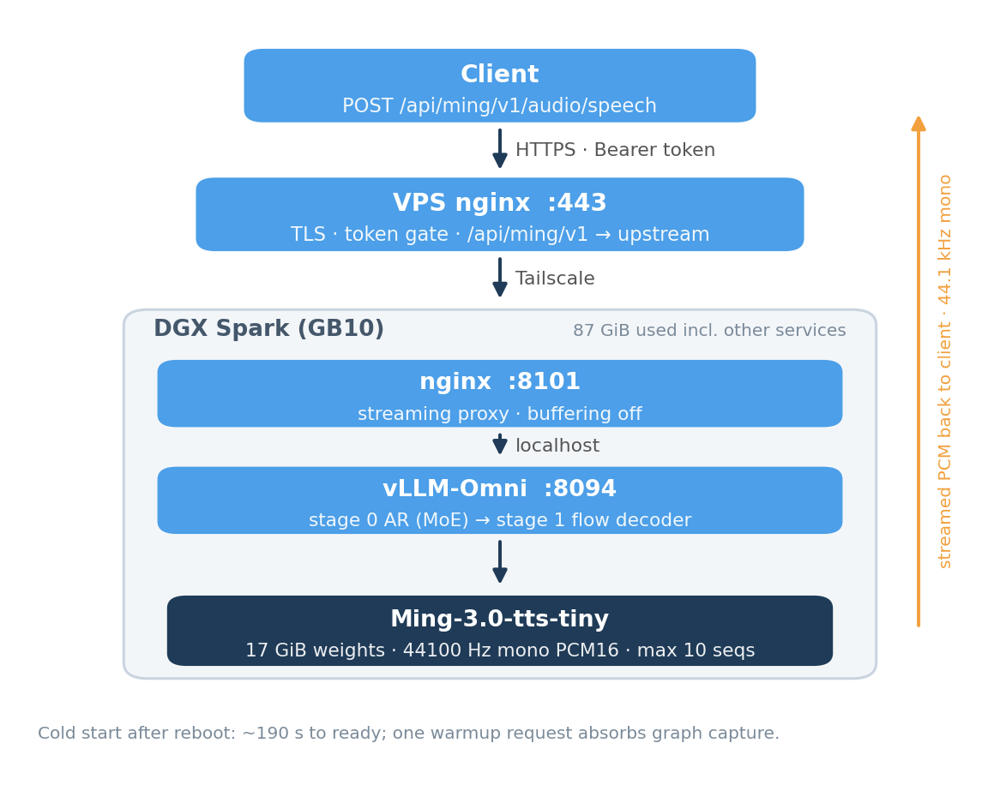
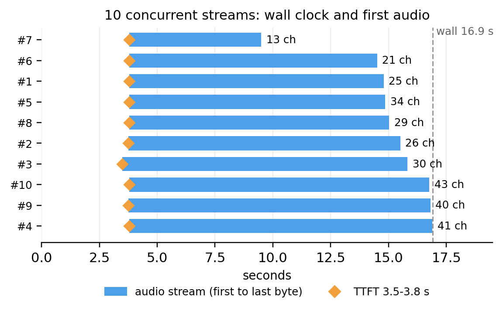

# dgx-spark-ming-tts

Ming-3.0-TTS tiny on one DGX Spark (GB10): 44.1 kHz streaming, ten concurrent
streams, one container, one command.

## Deployment status (2026-10-24)

The compose recipe builds and boots, but does **not** yet stand up a working
server on its own. Exercised end-to-end on a DGX Spark GB10:

| Stage | Result |
|---|---|
| image build (base + vllm 0.32 + overlay + patch) | passes |
| container import chain | passes after installing `deploy/tested-pip-freeze.txt` (was missing ~80 packages) |
| engine stage 0 weight load (30 shards) | passes |
| engine stage 1 model registration | **fails**: `Ming3TTSForConditionalGeneration` is not resolved by vllm's registry, API server crash-loops |

The serving deployment behind `tts.angineer.cn` predates this repository and
runs a hand-assembled container; the compose path has not reached parity with
it yet. Track the gap in the issue tracker before relying on `./deploy.sh` in
production. The dependency pinning above and the length-cap patch are correct
and worth keeping.

## Result

| Metric | Value |
|---|---|
| first audio, single stream, warm | 0.53 s |
| ten concurrent streams (302 characters) | 10/10, first audio 3.5–3.8 s, wall 16.9 s |
| aggregate text rate | ≈ 18 characters/s |
| output | 44100 Hz mono PCM16, rate reported in response headers |
| footprint | 17 GiB weights, ≈33 GiB reservation on a 121 GiB unified pool |





## Call the hosted API

Base URL: `https://tts.angineer.cn/api/ming/v1` — ask the operator for a key.

```bash
curl -s https://tts.angineer.cn/api/ming/v1/audio/speech \
  -H "Authorization: Bearer $MING_KEY" \
  -H "Content-Type: application/json" \
  -d '{"model":"ming3","input":"你好，世界。","response_format":"wav"}' \
  -o out.wav
```

Streaming PCM: add `"response_format":"pcm","stream":true,"stream_format":"audio"`.
Read `X-Audio-Sample-Rate` (44100) before playing raw PCM.

## Deploy your own

Prerequisites: DGX Spark (GB10), Docker with NVIDIA runtime, `docker compose`,
ports 8094 and 8101 free, about 40 GiB free disk, internet access.

```bash
git clone https://github.com/0mao0/dgx-spark-ming-tts.git
cd dgx-spark-ming-tts
./deploy.sh
```

`deploy.sh` downloads the 17 GiB weights on first run, builds the image
(vLLM 0.32.0 + the pinned vLLM-Omni overlay), starts the container, and waits
until the API answers. A cold start takes about 190 s. When it prints `ready`,
the API is at `http://<spark>:8094/v1` and the streaming proxy at
`http://<spark>:8101/v1`.

Slow network in mainland China: pass a mirror to the build.

```bash
PIP_INDEX_URL=https://mirrors.aliyun.com/pypi/simple ./deploy.sh
```

## API

`POST /v1/audio/speech`

| Field | Value |
|---|---|
| `model` | `ming3` |
| `input` | text, keep a single request at or below ~300 Chinese characters |
| `response_format` | `wav` or `pcm` |
| `stream` / `stream_format` | `true` / `audio` for chunked PCM |
| `language` | `Chinese` |
| `ref_audio` | optional http(s) or `data:` URL; omit for the default voice |
| `ref_text` | transcript of `ref_audio`; must match exactly |

## Reference voices

Without `ref_audio` the engine speaks with its built-in default voice. Cloning
any other voice needs a WAV plus its exact transcript; four ready-to-use
references ship in `voices/` (16 kHz mono PCM16, sample voices published with
the Apache-2.0 [CosyVoice](https://github.com/QwenAudio/CosyVoice) project):

| File | Voice | Audio |
|---|---|---|
| `voices/serena.wav` | Serena · female | 8.3 s |
| `voices/aiden.wav` | Aiden · male | 8.2 s |
| `voices/vivian.wav` | Vivian · female | 9.2 s |
| `voices/uncle_fu.wav` | Uncle Fu · male | 11.3 s |

All four transcripts read the same sentence: 各位同事，今天的施工例会改到下午三点，请大家准时到第二会议室，会后把材料交给我。

```bash
# streams the response and writes a 44.1 kHz WAV
python3 scripts/tts_with_ref.py --text "你好，这是一段克隆音色的试听。" \
  --ref voices/serena.wav --out cloned.wav
```

Bring your own: record 5–15 s of clean speech, convert to 16 kHz mono WAV, and
store the transcript in a `.txt` beside it. Shorter references clone but are
less stable; around 10 s is the sweet spot. `ref_text` must match the audio
word for word — a mismatch shifts prosody and can sound like a dialect.

## Notes

- **44.1 kHz, not 24 kHz.** Playing this stream as 24 kHz makes it 1.8× slow,
  one octave down, and muffled.
- **Cold start.** First batch after a restart can show a 45 s TTFT; the image
  runs a warmup request in the background to absorb it.
- **Pinned overlay.** vLLM-Omni PR #9198 (`091f7363`) is still a draft. The
  Dockerfile pins that commit; replace it with a released package once merged.
- **0.5B is a different model branch.** `Ming-3.0-tts-0.5B` is Qwen2.5 dense +
  DiT with patch size 1 and does not load in this pipeline (patch size 4).
- **`sample_rate` is rejected** by the current adapter for every value. Omit
  it; resample client-side if you need 24 kHz.
- **Voice cloning:** keep `ref_text` in a file next to the reference audio. A
  mismatched transcript shifts prosody and can sound like a dialect.

## Generation length and determinism

- **The stock checkpoint cuts every request at exactly 20.00 s.** The limit is
  `tts_config.maximum_decode_steps = 250` in `models/Ming-3.0-tts-tiny/config.json`
  (250 steps x 12.5 steps/s). Longer text is truncated mid-word and the stream
  still ends with a normal `speech.audio.done`, so clients see "complete" audio
  that stops halfway. `deploy.sh` raises it to 1000 (80 s); check with
  `python3 -c 'import json;print(json.load(open("models/Ming-3.0-tts-tiny/config.json"))["tts_config"]["maximum_decode_steps"])'`.
- **`max_tokens: 801` in the deploy YAML does not bound speech length.** The
  adapter overwrites stage sampling per request from the steps above.
  `MAX_DECODE_STEPS` in the overlay is only the ceiling for a per-request
  `max_new_tokens` (800 stock, 2400 in this image).
- **Temperature 0 does not make output reproducible; `seed` does.** The same
  text returned 35 s and 48 s on consecutive requests without a seed. Pass an
  explicit `seed` in the request body when you need a stable result.
- **Some seeds degenerate to 1.04 s of near-silence.** The model emits the end
  token after `minimum_decode_steps` (13) for unlucky seeds (e.g. 42 on a
  255-character text). Detect `duration < 2 s` and retry with another seed;
  3 attempts is plenty in practice.
- **Measured after the cap fix:** 194 Chinese characters read to the end in
  35–48 s depending on seed, wall time 16–19 s (RTF ≈ 0.47). Text beyond
  ~255 characters can still hit the 80 s ceiling — split long articles into
  paragraph-sized requests and concatenate.

## Client-side notes

- **Streaming has no known total length.** A progress bar filled from received
  bytes is a heuristic, not progress. Show "buffered ahead: X s" while frames
  arrive and switch to real progress only after `speech.audio.done`.
- **A dropped stream looks like success** unless you check for the done event.
  If the reader hits EOF without `speech.audio.done`, report the interruption
  and the seconds already generated; retry only when zero audio arrived.
- **Keep the received PCM to offer a full-file check.** Concatenating the
  frames and prepending a 44-byte RIFF header gives a WAV the user can replay
  and download without a second request.
- **Play at 44100 Hz, not 24 kHz**, and stop every scheduled `AudioBufferSource`
  when the user hits stop — stopping the fetch alone leaves queued audio playing.

## Operations

```bash
docker compose logs -f          # engine and proxy logs
docker compose restart          # restart the service
docker compose down             # stop; weights and image stay
./deploy.sh                     # idempotent re-deploy / update
```

Public HTTPS with a bearer token (optional): run `deploy/vps/install.sh` on a
VPS, as described in its header. The engine itself has no authentication; do
not expose 8094 or 8101 directly.

## Updating

The repo pins the base image tag, `vllm==0.32.0`, overlay `091f7363`, and
weights `8cf79a89`; upstream changes do not arrive until you change them.
When PR #9198 merges and a newer vllm-omni release ships, remove the overlay,
install that release, rebuild, and rerun `scripts/probe10.py`. Keep the
previous image tag for rollback. To move weights, delete
`models/Ming-3.0-tts-tiny` and rerun with `MODEL_REVISION=<sha> ./deploy.sh`.
`./scripts/check_upstream.sh` prints current upstream versions and changes
nothing.

## Credits

Model: `inclusionAI/Ming-3.0-tts-tiny`, MIT. Engine: vLLM-Omni, Apache-2.0,
PRs #9119 and #9198. Container, configs, probes, and charts: this repository,
Apache-2.0. Unofficial; not endorsed by inclusionAI or the vLLM-Omni authors.

## License

Apache-2.0, see [LICENSE](LICENSE) and [NOTICE](NOTICE).
